# ClubSphere – Student Organization Management System

## 📸 Project Screenshots

This section showcases the output screens of **ClubSphere**, a student organization management system designed to simplify club administration, student engagement, event management, and related activities.

The following screenshots demonstrate the application's user interface and the features available to administrators and students.

### 1. Admin Portal

The Admin Portal provides tools for managing student memberships, monitoring club activities, viewing analytics, and verifying event registrations.

#### Admin Login
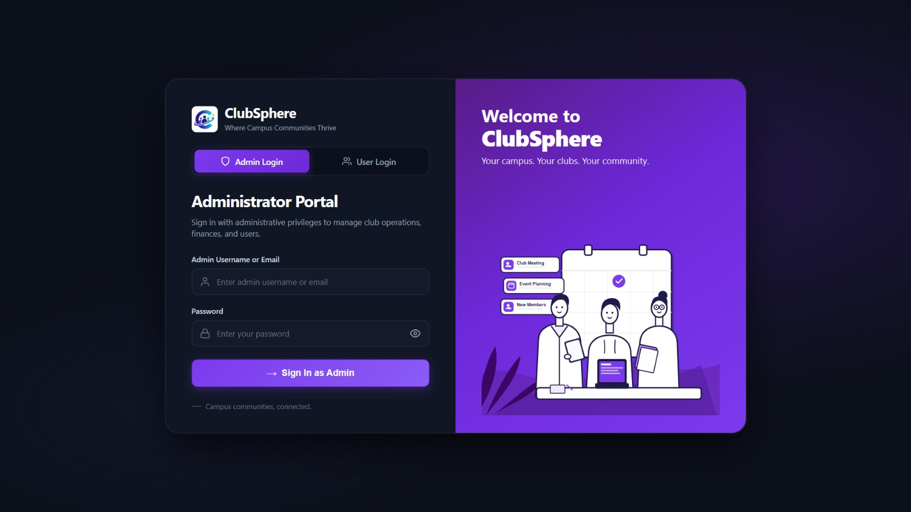

#### Admin Dashboard
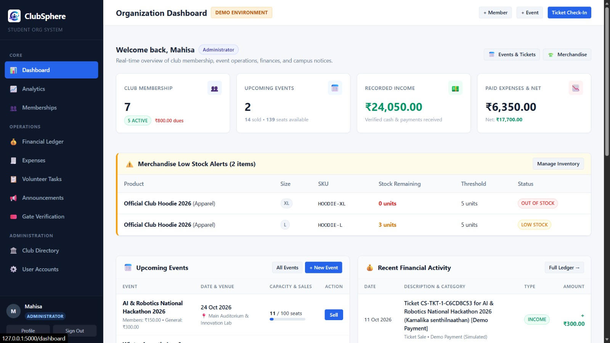

#### Admin Analytics
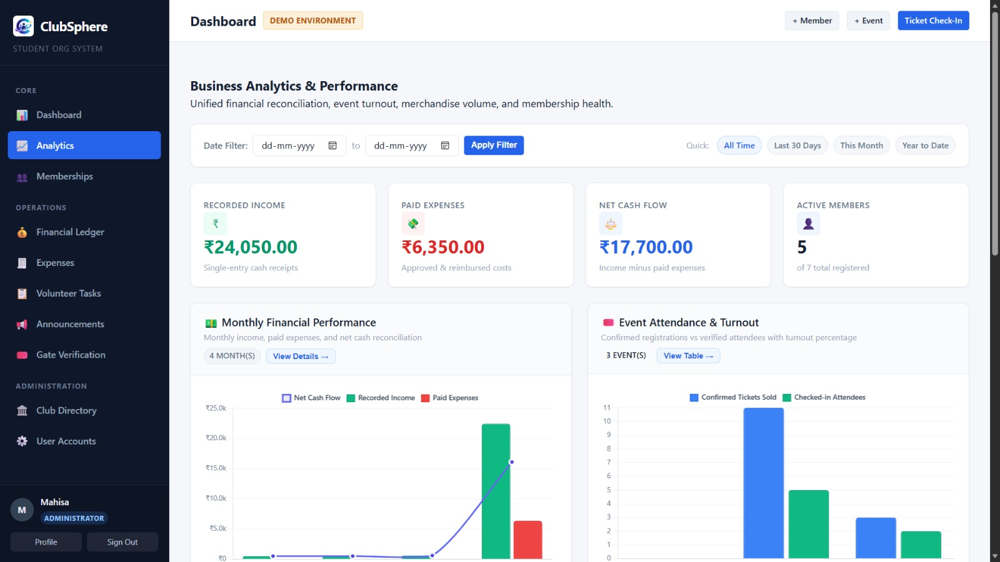

#### Admin Member Directory
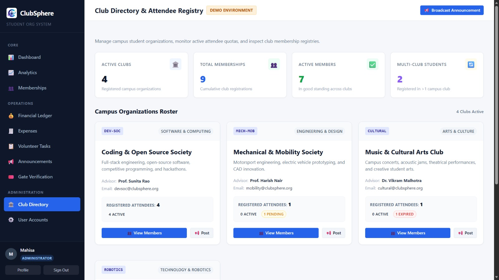

#### Admin QR Verification
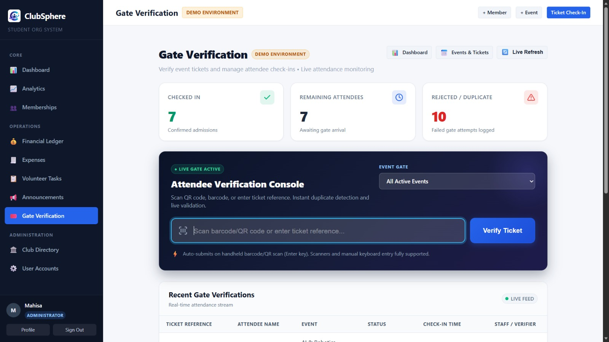

### 2. Student Portal

The Student Portal allows students to access their dashboard, explore club-related information, use the assistant, view credits, submit feedback, and manage event tickets.

#### Student Login
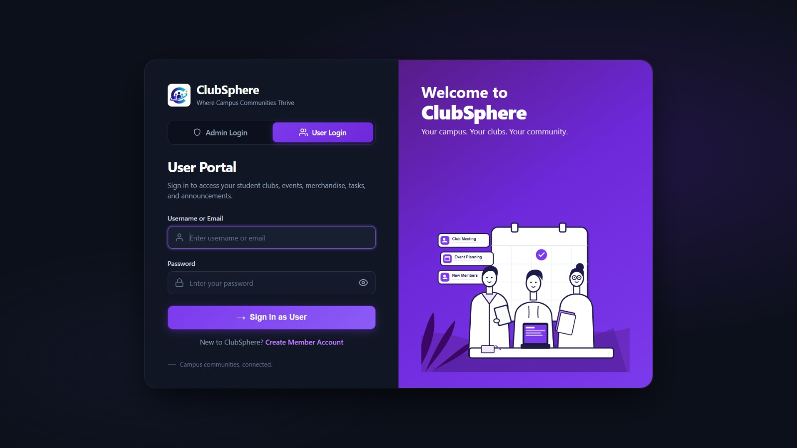

#### Student Dashboard
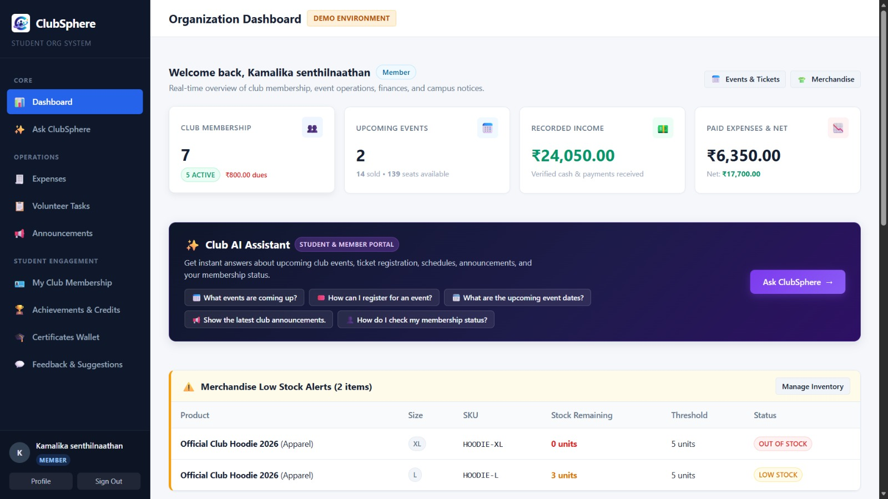

#### AI Club Assistant
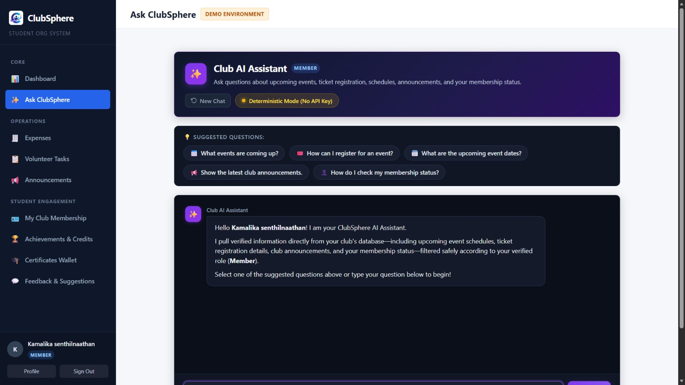

#### Student Credits
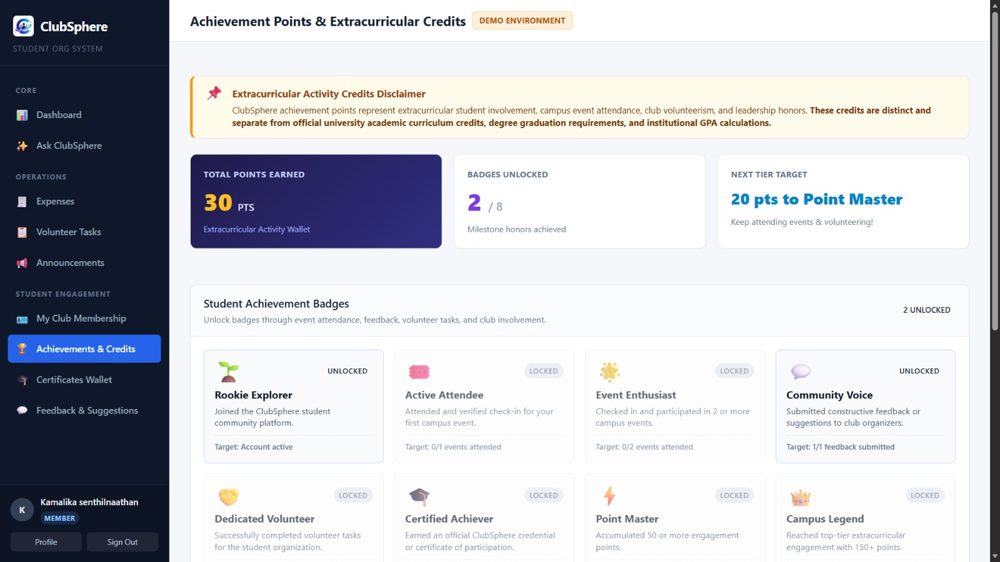

#### Student Feedback and Suggestions
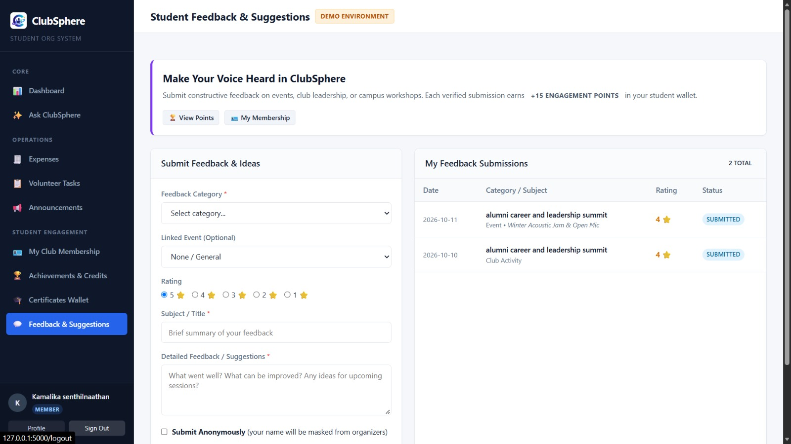

#### Event Tickets
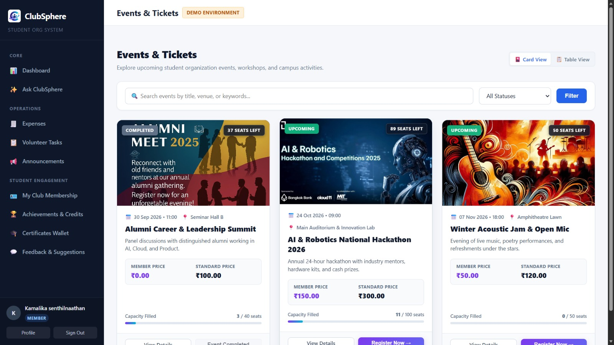

## Features Demonstrated

- Role-based access for administrators and students.
- Admin dashboard and analytics.
- Student membership directory management.
- Event ticket verification.
- AI-powered club assistance.
- Student dashboard and credits.
- Feedback and suggestions.
- Event ticket access and management.

## Note

All screenshots displayed in this section represent the output interface of the ClubSphere application. They are organized to provide a clear overview of the administrative and student-facing features.
